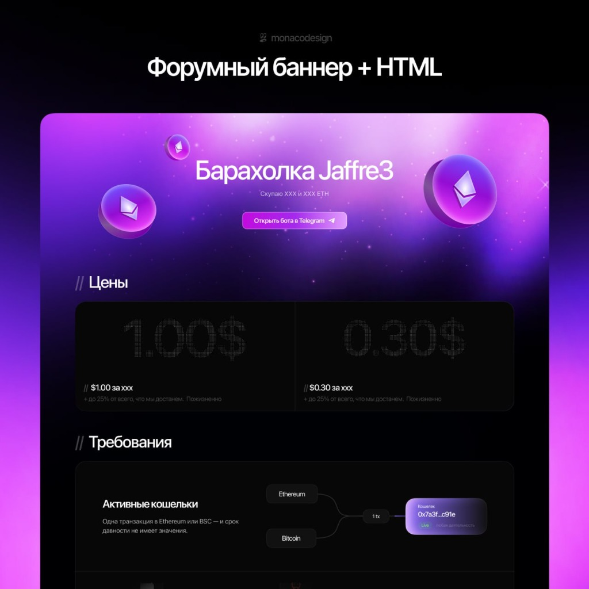

# ⚡ MAGNAT CONVERT // 3D Crypto & Currency Protocol

> Интерактивный веб-сайт с 3D конвертером валют и токенов, выполненный в стиле дизайн-макета forum banner & dark web3 (`monacodesign`).

🌐 **Онлайн Демо (GitHub Pages):** [https://dima11433.github.io/crypto-3d-converter/](https://dima11433.github.io/crypto-3d-converter/)  
📦 **Репозиторий:** [https://github.com/Dima11433/crypto-3d-converter](https://github.com/Dima11433/crypto-3d-converter)



## ✨ Особенности проекта

- **1:1 Визуальный стиль по референсу:**
  - Глубокий обсидиановый фон (`#06050b`) с многослойными космическими туманностями и фиолетово-фуксиевым неоновым свечением.
  - Плавающие в пространстве глянцевые стеклянные сферы со кристаллами Ethereum внутри, реагирующие на движение мыши с мягким параллаксом.
  - Карточки с неоморфной/стеклянной отделкой, тонкими волосяными границами и микроподсветкой.
  - Заголовок `MAGNAT CONVERT` с кнопкой `Открыть бота в Telegram ↗`

- **Интерактивный 3D Движок (Three.js):**
  - **Сцена Hero:** Три глянцевые парящие полупрозрачные сферы с кристаллами Ethereum (точно как на картинке: малая вверху слева, средняя слева, крупная с бликом справа), плавно качающиеся на волнах с микрозвездами.
  - **Интерактивная сцена токена:** Вращайте любую 3D модель на 360° мышью или пальцем на сенсорном экране.
  - **Переключение материалов токена:** Фиолетовый кристалл, 24K Золото, Кибер-хром, Неоновое стекло.
  - Динамическая подгрузка 3D моделей при смене валюты: Ethereum, Bitcoin, Solana, Fiat-монеты.

- **Полнофункциональный Конвертер Валют:**
  - **Интеграция с Wise (TransferWise):** реальные курсы валют берутся напрямую с [Wise Currency Converter](https://wise.com/ru/currency-converter/) (официальный среднерыночный курс mid-market без скрытых банковских наценок: USD, EUR, RUB, KZT, UAH, GBP, CNY, JPY, CHF, CAD, AUD, PLN, TRY, AED).
  - Поддержка криптоактивов (`ETH`, `BTC`, `SOL`, `TON`, `USDT`, `BNB`, `XRP`) и кросс-курсов криптовалюта ↔ фиат.
  - Быстрый обмен местами с 3D анимацией вращения и аудиоэффектом.
  - Чипы быстрого ввода сумм (0.1, 0.5, 1.0, 5.0, 10 ETH).
  - Модальное окно выбора валюты с живым поиском и фильтрацией по категориям (Все / Крипта / Фиат).
  - Автоматический расчет стоимости газа, комиссий и сетевого сбора в реальном времени.
  - Автоматический периодический синк свежих курсов Wise через GitHub Actions.

- **Звуковой синтезатор (Web Audio API):**
  - Чистый синтез звуков переключения, свапа и подтверждения прямо в браузере без внешних тяжелых mp3 файлов.
  - Кнопка выключения/включения звука в шапке.

- **Адаптивность и производительность:**
  - 100% адаптив под смартфоны, планшеты и 4K-мониторы.
  - Zero-build architecture — запускается прямо открытием `index.html` или через GitHub Pages.

---

## 🚀 Быстрый запуск

### Вариант 1: Открытие напрямую
Просто откройте `index.html` в любом современном браузере.

### Вариант 2: Локальный сервер
```bash
# Python
python -m http.server 8080

# Node.js
npx serve .
```

---

## 🛠 Стек технологий

- **HTML5 & Modern Web Standards:** декларированная поддержка `color-scheme: dark`, семантика, доступность.
- **Modern CSS:** Glassmorphism, CSS Custom Properties, градиентная сетка, аппаратное ускорение анимаций.
- **Three.js:** WebGL рендеринг, физические материалы `MeshPhysicalMaterial`, расчет отражений и преломлений света (IOR).
- **Web Audio API:** Синтез звуковых сигналов на основе осцилляторов и огибающих громкости.
- **Vanilla JavaScript (ES6+):** Реактивный расчет курсов без лишних тяжелых фреймворков.

---

## 📄 Лицензия
MIT &bull; Разработано для тестирования и презентации.
Дизайн вдохновлен работой `monacodesign`.
